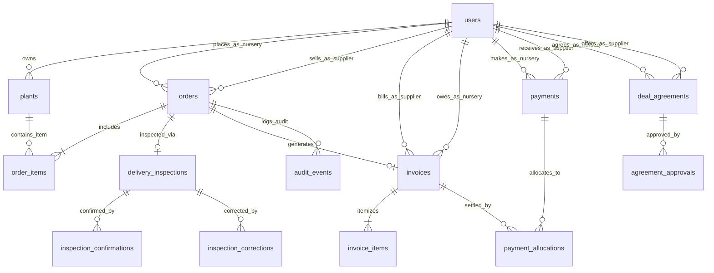

# 🏛️ FloraChain B2B — Comprehensive System Architecture

**Document Version:** 2.0  
**Last Updated:** November 3, 2026  
**Target Codebase:** `supplier_platform/`  

---

## 1. High-Level Architecture Overview

FloraChain B2B is structured as a decoupled, multi-tier web application built without complex framework overhead, ensuring maximum transparency, maintainability, and auditability for commercial nursery transactions.

```
┌────────────────────────────────────────────────────────────────────────┐
│                        PRESENTATION LAYER (SPA)                        │
│            Vanilla HTML5 / CSS3 / ES6 JavaScript (Zero npm build)      │
│  - Supplier Portal: Catalog, Staging, Manifests, Invoicing, Ledger     │
│  - Nursery Buyer Portal: Inbound Deliveries, POs, Statements, Receipts │
│  - Responsive FloraChain Design System (#063B00 brand green theme)    │
└───────────────────────────────────┬────────────────────────────────────┘
                                    │ HTTP / REST JSON APIs
                                    │ Cookie-Auth + CSRF Token Header
┌───────────────────────────────────▼────────────────────────────────────┐
│                    APPLICATION & SERVICE LAYER (Flask)                 │
│         Python 3.10+ Application Factory (`create_app`)                │
│                                                                        │
│  ┌────────────────────────┐  ┌──────────────────────────────────────┐  │
│  │   REST Blueprints      │  │        Domain Service Engines        │  │
│  │  - auth_routes         │  │  - inspection_service (Verification) │  │
│  │  - plant_routes        │  │  - invoice_service (Sound Billing)   │  │
│  │  - order_routes        │  │  - payment_service (Advance Alloc)   │  │
│  │  - truck_routes        │  │  - interest_service (Daily Accrual)  │  │
│  │  - invoice_routes      │  │  - ledger_service (Double-Entry)     │  │
│  │  - payment_routes      │  │  - audit_service (Immutable Trail)   │  │
│  │  - ledger_routes       │  │  - nursery_dashboard_service         │  │
│  │  - nursery_routes      │  └──────────────────────────────────────┘  │
│  │  - agreement_routes    │                                            │
│  │  - admin_routes        │  ┌──────────────────────────────────────┐  │
│  └────────────────────────┘  │ Security: Session, CSRF, RBAC Guard  │  │
│                              └──────────────────────────────────────┘  │
└───────────────────────────────────┬────────────────────────────────────┘
                                    │ SQL Queries & Parameterized Binds
                                    │ Dual-Engine Adapter Layer
┌───────────────────────────────────▼────────────────────────────────────┐
│                         PERSISTENCE LAYER                              │
│                                                                        │
│   [ Default Active Engine ]                [ Enterprise Option ]       │
│           SQLite 3                               PostgreSQL 15+        │
│   - Embedded zero-config                   - Production clustering     │
│   - Write-Ahead Logging (WAL)              - Connection pooling        │
│   - Relational Foreign Keys                - Sequence auto-sync        │
└────────────────────────────────────────────────────────────────────────┘
```

---

## 2. Relational Entity-Relationship Model (14 Tables)



### Table Definitions & Relational Integrity
1. **`users`**: Platform actors (`id`, `username`, `email`, `password_hash`, `role`, `business_name`, `created_at`). Roles: `SUPPLIER`, `NURSERY`, `ADMIN`.
2. **`plants`**: Inventory stock (`id`, `supplier_user_id`, `name`, `category`, `unit`, `unit_price`, `stock_qty`, `status`).
3. **`orders`**: Commercial purchase orders (`id`, `nursery_user_id`, `supplier_user_id`, `status`, `total_amount`, `truck_number`, `driver_name`, `driver_contact`, `created_at`).
4. **`order_items`**: Line items (`id`, `order_id`, `plant_id`, `quantity`, `unit_price`, `subtotal`).
5. **`delivery_inspections`**: Physical count at nursery gate (`id`, `order_id`, `inspector_name`, `ordered_qty`, `delivered_qty`, `sound_qty`, `damaged_qty`, `inspection_notes`, `status`).
6. **`inspection_confirmations`**: Dual-party digital signoffs (`id`, `inspection_id`, `confirmed_by_role`, `user_id`, `status`).
7. **`inspection_corrections`**: Discrepancy correction tracking (`id`, `inspection_id`, `proposed_by_user_id`, `approved_by_admin_id`, `old_sound_qty`, `new_sound_qty`).
8. **`invoices`**: Official wholesale billing document (`id`, `order_id`, `supplier_user_id`, `nursery_user_id`, `invoice_number`, `gross_amount`, `discount_amount`, `tax_amount`, `net_amount`, `due_date`, `status`).
9. **`invoice_items`**: Billing line items derived strictly from accepted sound plants (`id`, `invoice_id`, `plant_id`, `quantity`, `unit_price`, `subtotal`).
10. **`payments`**: Financial receipts (`id`, `nursery_user_id`, `supplier_user_id`, `amount`, `payment_method`, `reference_no`, `payment_date`, `unallocated_balance`).
11. **`payment_allocations`**: Many-to-many allocation of payments to open invoices (`id`, `payment_id`, `invoice_id`, `amount_allocated`, `allocated_at`).
12. **`deal_agreements`**: Negotiated trade terms (`id`, `supplier_user_id`, `nursery_user_id`, `credit_period_days`, `interest_rate_pct`, `grace_period_days`, `status`).
13. **`agreement_approvals`**: Bilateral approval records (`id`, `agreement_id`, `user_id`, `role`, `status`).
14. **`audit_events`**: Immutable event log (`id`, `order_id`, `action`, `actor_user_id`, `actor_role`, `before_state_json`, `after_state_json`, `created_at`).

---

## 3. Frontend Architecture

* **Architecture Style:** Vanilla Single Page Application (SPA).
* **Zero-Build Pipeline:** Pure HTML5 markup, CSS3 styling, and ES6 JavaScript modules loaded directly by the browser without Babel, Webpack, or Vite bundling steps.
* **Component-Based DOM:**
  * **Supplier Portal View (`#view-supplier`):** Overview KPI summary cards, Orders subpage, Plants catalog, Staging & Logistics, Invoices, Payments, Ledger statements.
  * **Nursery Buyer Portal View (`#view-nursery`):** Inbound shipments tracker, Purchase orders table, Wholesale invoices, Financial account statement, Deal agreements.
  * **Interactive Modals:** Add Plant modal, Create Order modal, Order Detail modal with expandable audit trail, Delivery Verification modal, Record Payment modal, Advance Allocation modal.
* **Security & Network Layer:**
  * Global fetch wrapper attaching CSRF token (`X-CSRF-Token`) on all mutating requests.
  * Dynamic header updating user session context (`updateActiveUserHeader()`).
  * Strict error-boundary handling: Network failures never cause optimistic UI state changes (e.g. delivery verification fails safe without auto-locking).

---

## 4. Backend Application Architecture (Flask Factory)

* **Application Factory (`create_app` in `app/__init__.py`):**
  * Initializes configuration from `app/config.py` based on `FLASK_ENV` (`development`, `testing`, `production`).
  * Attaches centralized logging with configurable `LOG_LEVEL`.
  * Enforces consistent JSON error formatting for all `/api/` endpoints (400 Bad Request, 404 Not Found, 405 Method Not Allowed, 500 Internal Error).
  * Injects security response headers (`X-Content-Type-Options: nosniff`, `X-Frame-Options: DENY`, `X-XSS-Protection: 1; mode=block`).
  * Validates session cookies and enforces per-session CSRF tokens on state-changing methods (`POST`, `PUT`, `PATCH`, `DELETE`).
* **Modular Blueprint Routing:**
  * `auth_bp` (`/api/auth`): Login, logout, current session inspection (`/me`), and local dev role switching (`/switch-role`).
  * `plant_bp` (`/api/plants`): CRUD operations for wholesale botanical inventory.
  * `order_bp` (`/api/orders`): Order creation, lifecycle updates, detail queries, and audit trail retrieval.
  * `inspection_bp` (`/api/delivery-inspections`): Inspection submission, dual-party confirmation signoffs, and correction disputes.
  * `truck_bp` (`/api/truck-loadings`): Logistics vehicle logging and dispatch staging.
  * `invoice_bp` (`/api/invoices`): Delivered-sound billing generation and cancellations.
  * `payment_bp` (`/api/payments`): Payment recording, advance balance tracking, and counterparty-isolated allocation.
  * `ledger_bp` (`/api/ledger`): Double-entry ledger entries, statements, and commercial summaries.
  * `nursery_bp` (`/api/nursery`): High-level buyer dashboard metrics.
  * `agreement_bp` (`/api/agreements`): Commercial terms negotiation and bilateral approvals.
  * `admin_bp` (`/api/admin`): Administrative audit trails and system inspections.
  * `static_bp` (`/`): Serves the frontend single-page interface and assets.

---

## 5. Domain Service Calculation Engines

### 1. Delivery Inspection & Dual-Party Verification Engine (`inspection_service.py`)
* Computes accepted sound plants:
  $$\text{sound\_qty} = \text{delivered\_qty} - \text{damaged\_qty}$$
* Enforces physical balance checks: rejects negative quantities, fractional counts, and mismatched sums ($\text{sound} + \text{damaged} \neq \text{delivered}$).
* Order locking state machine: An order transitions to `DELIVERED` and `LOCKED` only when both Supplier and Nursery submit digital confirmations. Ordinary modifications after locking are strictly rejected.

### 2. Delivered-Sound Invoicing Engine (`invoice_service.py`)
* Automatically generates wholesale invoices strictly derived from the verified `sound_qty`.
* Protects buyers: nursery buyers are never billed for plants damaged during road transport or unfulfilled items.
* Computes due dates dynamically:
  $$\text{Due Date} = \text{Delivery Date} + \text{Agreed Credit Period Days}$$

### 3. Payment & Advance Allocation Engine (`payment_service.py`)
* Tracks payments across cash, cheque, UPI, and bank transfer.
* Supports unallocated advances: when a payment exceeds open invoices, the excess is stored as `unallocated_balance`.
* Counterparty Isolation: Strictly verifies that advance allocations match counterparties:
  $$\text{Payment Nursery ID} == \text{Invoice Nursery ID} \quad \text{and} \quad \text{Payment Supplier ID} == \text{Invoice Supplier ID}$$

### 4. Agreed Late-Payment Interest Engine (`interest_service.py`)
* Calculates daily interest on overdue principal beyond the agreed grace period according to bilateral deal agreements:
  $$\text{Daily Interest} = \text{Overdue Principal} \times \left(\frac{\text{Annual Interest Rate \%}}{100 \times 365}\right)$$
* Prevents premature charges: invoices within their credit window or grace period accrue ₹0.00 interest.

### 5. Double-Entry Accounting Ledger Engine (`ledger_service.py`)
* Maintains an immutable record of all debit and credit movements:
  * **Debit (+ Balance Due):** Invoices billed, interest accrued.
  * **Credit (- Balance Due):** Payments received and allocated.
* Reconciles commercial statements in real time:
  $$\text{Net Balance Due} = \text{Total Billed} - \text{Total Settled} - \text{Unallocated Advances} + \text{Accrued Interest}$$

---

## 6. Dual-Engine Database Architecture

FloraChain features an abstraction layer (`app/models/database.py`) supporting both SQLite and PostgreSQL without requiring code changes in service engines:

1. **Dialect Detection:** Automatically inspects the environment:
   * If `DATABASE_URL` is set to a valid PostgreSQL URI (`postgresql://...`), activates the PostgreSQL connection pool.
   * If `DATABASE_URL` is unset, activates the SQLite embedded engine pointing to `FLORACHAIN_DB_PATH` (default: `data/florachain.db`).
2. **SQL Placeholder Translation:** Translates SQLite positional `?` parameter markers to PostgreSQL `%s` markers on the fly, while safely ignoring `?` characters inside string literals.
3. **Identifier Normalization:** Adapts reserved keywords and column casting between SQLite dynamic typing and PostgreSQL strict types.
4. **Sequence Synchronization:** Automatically recalculates and synchronizes PostgreSQL `BIGSERIAL` identity sequences (`setval(..., max(id))`) after data insertions or bulk migrations.
